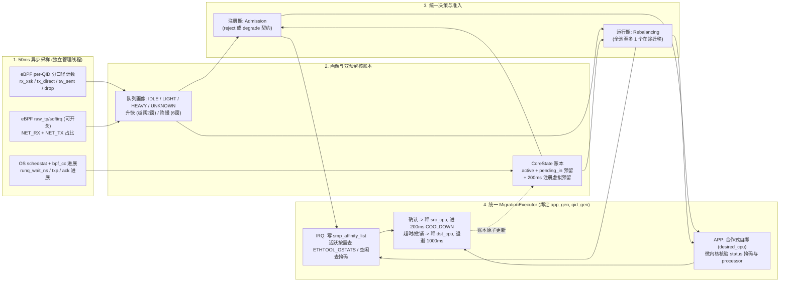
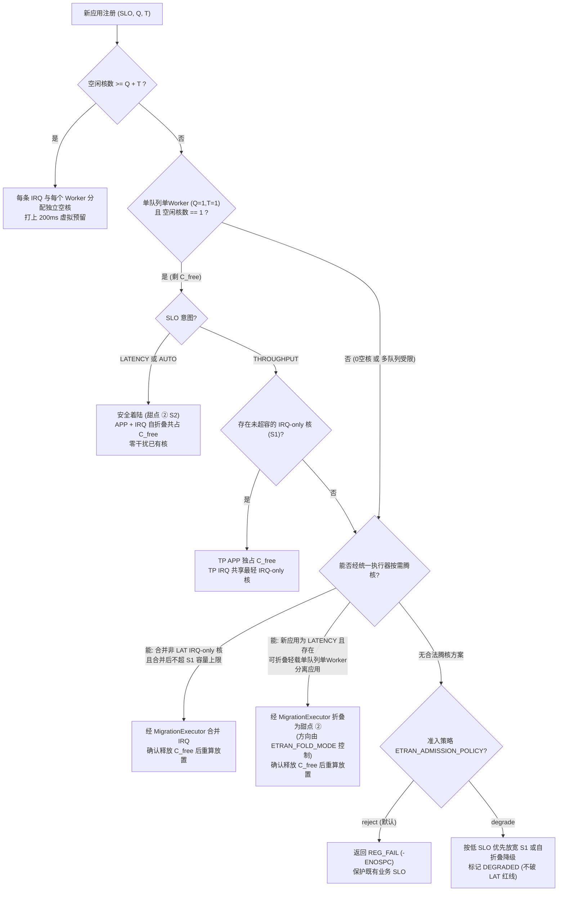
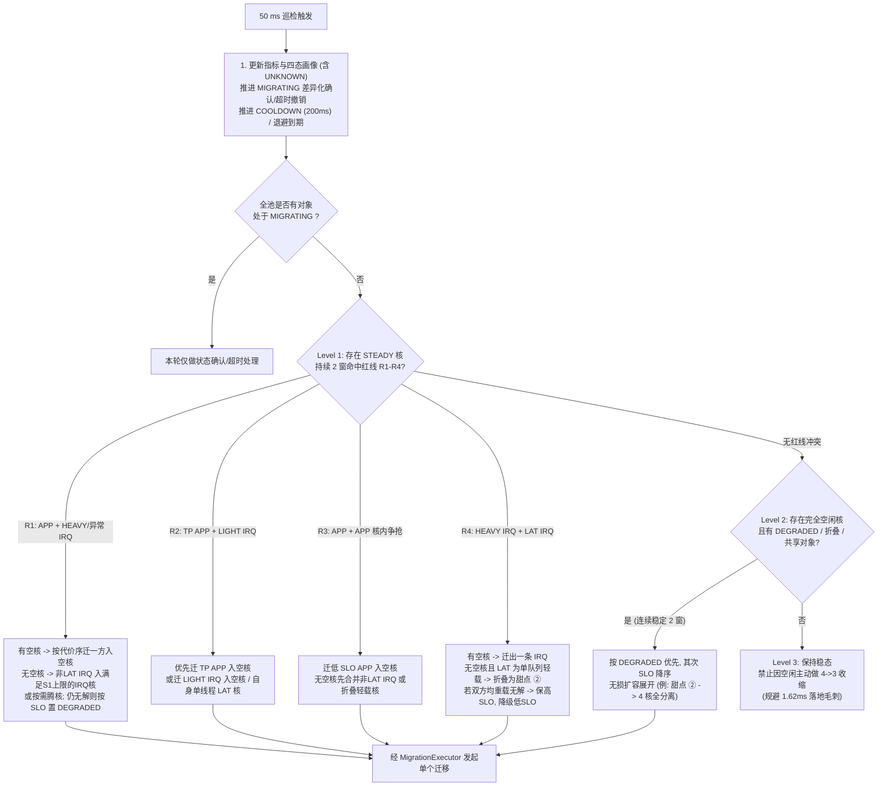

# eTran 负载指标体系与动态核池调度设计方案

本文档承接 [01-baseline-cleanup.md](../queue-core-decoupling/01-baseline-cleanup.md)、[02-driver-decoupling-design.md](../queue-core-decoupling/02-driver-decoupling-design.md) 与 [03-live-irq-migration-fix.md](../queue-core-decoupling/03-live-irq-migration-fix.md)，面向已完成队列/CPU 动静态全解耦的双机实验基线（`6.6.0-eTran-compat3.3`、`nosmt` 24 物理核、24 Combined 通道，参见 [kernel-patches/README.md](../../kernel-patches/README.md)），给出下一阶段 **可信负载指标体系、二维正交建模与准入/降级策略、闭环迁移执行器、全栈无竞态改造** 以及 **分阶段灰度验收计划** 的完整设计。

---

## 1. 设计目标与边界约定

### 1.1 解决的核心问题

原版 eTran 依赖静态 `App ↔ AF_XDP ↔ NIC Queue ↔ CPU Core` 绑定链，在受限核池多应用混布时无法隔离时延敏感型与吞吐导向型业务；早期改版（`eTran+`）采用 `/proc/stat` 同步采样 + 静态二元标签（`LATENCY` / `THROUGHPUT`）存在四项根本局限：

1. **指标失真**：忙轮询线程在 `/proc/stat` 下恒显 `100% user`，且内核未开 `CONFIG_IRQ_TIME_ACCOUNTING` 导致软中断与用户态记账混同，注册期同步 `usleep(100ms)` 还会阻塞微内核 `200 µs` 周期的拥塞控制环路；
2. **仅静态一次性拍板**：无法应对运行期突发变载（轻载变满载）或应用退出后的核释放展开，也缺少核满无解时的显式准入与降级契约；
3. **单一二元标签失灵**：难以刻画高性能网络中普遍存在的**双属性应用**（如高 QPS 低时延 KV/RPC、同进程前台小包与后台大流并存、阶段性时变业务）及无标签默认应用；
4. **迁核粒度与生命周期不闭环**：仅按进程 `PID` 或全进程统一设亲和性无法在不互相踩踏的前提下独立迁移多线程应用（`-t > 1`）的单个 busy-poll worker，且缺少迁移确认、失败回滚与注销排空栅栏。

### 1.2 范围与架构边界

1. **协议、队列容量与核池并发边界**：
   - 本阶段聚焦 **TCP + 独占硬件队列（`Q_EXCLUSIVE`）**；`Q_SHARED` 队列级所有权与 Homa 跨核留作后续独立扩展。
   - 必须明确区分**“硬件队列可分配槽位容量（24 条 Combined 通道）”**与**“受限核池（如 3 / 4 / 6 核）可无损承载的并发应用规模”**：核池并发性能上限取决于物理核数与负载组合，须由阶段验收矩阵单独测算，而非由队列数外推。
2. **拓扑边界**：沿用 [01-baseline-cleanup.md](../queue-core-decoupling/01-baseline-cleanup.md) 约定——调度机制对 `ETRAN_CPU_POOL` 内全部可用核 **NUMA 一视同仁**，同 NUMA 受限核实验与跨 NUMA 对照实验均由环境变量 `ETRAN_CPU_POOL` 与 `ETRAN_CP_CPU` 外部框选。
3. **安全信任边界（分层指标演进）**：
   - **一期（必选、100% 特权可信）**：全部指标采集自 **微内核 + 内核 eBPF + OS procfs**，应用零修改，严格遵守 eTran “不信任用户态应用”的隔离哲学；
   - **二期（备选、按收益决策）**：用户态 `libetran` 共享内存指标（如轮询空洞 `max_poll_gap_ns`、有效轮询比 `useful_poll_ratio`）暂不纳入一期主干，待一期实测后再根据计算密集型应用或微秒级受害早筛的实测收益决定是否引入（引入时须经微内核交叉校验防谎报）。
4. **核间隔离 vs 队列内隔离边界**：本方案解决**不同队列、不同线程对物理核算力与 NAPI 软中断的核间争抢**；单连接/单队列内部混杂大包与小包引起的队头阻塞（HoL Blocking）由流分类拆队列（Flow Director / 多端口）或传输协议优先级队列负责。
5. **多队列应用折叠边界**：现有 [eTran_common.cc](../../eTran/lib/eTran_common.cc#L146-L177) 为每个 worker 线程建立了覆盖全部已分配队列的 XSK，`(q_i, w_i)` 下标配对不能证明收发归属。因此，**多 worker 应用的首版支持按单个 worker 独立迁移，但同应用 `APP + IRQ` 甜点折叠仅在 `nr_nic_queues == 1 && nr_app_threads == 1` 时启用**；多队列/多 worker 的同应用折叠待后续建立明确的 `queue ↔ worker` 流量归属映射后再开放。

---

## 2. 实证依据：共置规律、迁移代价与指标排雷

本方案的核心约束与验收目标锚定前期双机实测结果（本地原始归档位于 `experiments/20261122-numa0-colocation/`、`experiments/20261125-compat32-numa0-colocation/`、`experiments/20261125-live-migration-probe/` 与 `experiments/20261125-live-irq-handoff/`，关键结论已固化于 [02-driver-decoupling-design.md](../queue-core-decoupling/02-driver-decoupling-design.md) 与 [03-live-irq-migration-fix.md](../queue-core-decoupling/03-live-irq-migration-fix.md)）：

### 2.1 布局本身实测基准（自动选中并稳定维持仍需本阶段验收）

| 布局 | 核内共置关系 | TP 有效吞吐 (Gbps) | LAT p99 / p99.9 (µs) | 调度定性 |
| :--- | :--- | ---: | ---: | :--- |
| `0` 全分离 | 4 核完全隔离 | `19.64` | `19.79 / 24.59` | 4 核验收目标布局 |
| `①` | `TP APP + TP IRQ` | `3.57` (`-82%`) | `16.89 / 19.61` | **硬红线（吞吐坍塌）** |
| `②` | `LAT APP + LAT IRQ`（轻载） | `19.75` | `28.79 / 41.84` | **3 核验收目标布局（仅当 `LAT IRQ` 为 `LIGHT` 时成立）** |
| `③` | `LAT APP + TP IRQ` | `20.01` | `666.94 / 768.31` (`×34`) | **硬红线（长时共置偶发停滞）** |
| `④` | `TP APP + LAT IRQ` | `2.58` (`-87%`) | `15.57 / 18.89` | **硬红线（吞吐坍塌）** |
| `⑤` | `TP APP + LAT APP` | `5.09` (`-74%`) | `22.28 / 4,850.58` (`4.3–8.0 ms`) | **硬红线（双输抢占）** |
| 多队列共 IRQ 核 | `Q8 + Q6 → 同一 IRQ 核`（APP 分核） | `~13.68+`（含重绑/跟踪） | — | **合法折叠位**（`compat3.1` 用例 3 验证 20 轮重绑零断流） |

### 2.2 `compat3.3` 在线迁核实测代价与时间常数口径

- **双自由度均已打通且轻量**：
  - `IRQ` 交接耗时 `10.75–47.61 µs`（`55/55` 次活跃切换获目标核首轮 `poll` 确认，`aff_handoff_retry = 0`、`aff_handoff_timeout = 0`）；
  - 纯 `LAT` 迁 `IRQ`（`3A`）过渡窗最大 RTT 仅 `24.27–26.91 µs`（超 `30 µs` 样本数为 `0`），纯 `LAT` 迁 `APP`（`3B`）最大 RTT 仅 `24.29 µs`；
  - 重度 Paced 发端（同队列“一慢三快”四连接）即使出现 `315–628 µs` 双核时间轮重叠提交，依然 **`0` 重传、`0` 残留**，50 ms 最大降幅仅 `3.74%`，`55.5–98.2 ms` 恢复至稳态 95%；
  - 在线解救 `③` 时，迁 `TP IRQ`（`637.68 → 19.63 µs`）与迁 `LAT APP`（`677.44 → 19.70 µs`）均在 `100 ms` 内确认恢复；解救 `④` 迁 `TP APP` 仅 `67.8 ms` 恢复 95% 吞吐且对 `LAT` 最大扰动 `38.12 µs`。
- **显著的非对称扩缩毛刺**：
  - `3 → 4` 扩容展开（`LAT APP` 迁往空闲核）：过渡最大 RTT 中位数仅 **`45.45 µs`**；
  - `4 → 3` 收缩折叠（`LAT APP` 迁入运行中 `LAT IRQ` 非空核）：三轮均出现约 **`1.62 ms`** 落地毛刺。
- **时间常数与依据区分**：
  - `T_sample = 50 ms`（采样周期）；
  - `T_cooldown_irq = 200 ms`（已有 `compat3.3` `200 ms × 20` 次高频往返直接覆盖）；
  - `T_cooldown_app = 200 ms`（基于 `compat3.2` 单次解救 `< 100 ms` 恢复余量作为初始保守值，后续高频回归补充标定）。

### 2.3 已排雷的 4 类失效指标

1. **`/proc/stat`**：忙轮询恒显 `100% user`，且未开 `CONFIG_IRQ_TIME_ACCOUNTING`。
2. **标准 netdev `sysfs`（`/sys/class/net/<if>/statistics/`）**：实测对 AF_XDP 零拷贝流量几乎不计数；硬件 `eth-mac` 计数为整口聚合，无法分清队列。
3. **`/proc/interrupts` 硬中断计数**：开启 `napi_defer_hard_irqs = 100` 与 `gro_flush_timeout = 200 ns` 后，高负载持续跑流靠 `hrtimer` 自转，硬中断增量可为 `0`。
4. **单独使用 `pkt_queue_pending()`**：满载 20 Gbps 单流命中 `BYPASS_RL` 直发时时间轮深度为 `0`；而在历史 `③` 停滞现场（`experiments/20261122-numa0-colocation/mixed-mechanisms/README.md`），曾观测到 `Q8` 网卡收发与 NAPI 计数彻底停滞，但 `CPU8` 上 `NET_TX` 仍狂飙（`ksoftirqd/8` 占 `273/399 ms`、`nr_pkts_in_tw` 滞留 `996`）。因此必须把**尝试、成功提交、积压与无进展信号**分开统计。

---

## 3. 一期可信负载指标体系与对照方案

### 3.1 严格区分三类内核侧数据源

#### 数据源 A（必选主干）：eBPF per-QID 分口径流量与进展 Map
针对 [eTran/micro_kernel/eBPF/tcp/main.c](../../eTran/micro_kernel/eBPF/tcp/main.c#L222-L259) 与 [pacing.h](../../eTran/micro_kernel/eBPF/tcp/pacing.h) 的真实执行路径，在 [intf_ebpf.h](../../eTran/common/intf/intf_ebpf.h) 中严格区分**收包递交、直发尝试、时间轮入队尝试、时间轮实际提交与丢弃**，避免把 `ret == XDP_PASS`（回环转回 `xsks_map`）误算作发包，也不把 `XDP_REDIRECT`（发生在实际入轮之前）误当成已成功入轮：

```c
struct bpf_qid_stats {
    __u64 rx_xsk_pkts;      // xdp_sock_prog 经 tcp_rx_process 返回 XDP_REDIRECT 递交至应用 XSK 的包数
    __u64 rx_xsk_bytes;     // 对应字节数
    __u64 tx_direct_pkts;   // xdp_egress_prog 严格命中 ret == XDP_TX 的直发尝试包数（排除 XDP_PASS 回环与 XDP_DROP）
    __u64 tx_direct_bytes;  // 对应字节数
    __u64 tw_enq_attempts;  // xdp_egress_prog 命中 ret == XDP_REDIRECT 的尝试入轮次数（非成功提交）
    __u64 tw_sent_pkts;     // pacing.h tw_cb() 经 bpf_packet_send() 实际成功发送的包数
    __u64 tw_sent_bytes;    // 对应字节数
    __u64 tw_drop_pkts;     // tw_cb() 发送失败/异常丢弃包数
} __attribute__((aligned(64)));
```

- **口径与并发说明**：`rx_xsk_*`、`tx_direct_*`、`tw_enq_attempts` 位于该独占队列的 NAPI 上下文，单核写零锁；`tw_sent_*` 与 `tw_drop_pkts` 位于时间轮 `NET_TX` 回调，在 `compat3.3` 在线迁核的数百微秒双核重叠窗口内可能短暂跨核并发，应采用 `BPF_MAP_TYPE_PERCPU_ARRAY`（或对该三个字段独立做 per-CPU 统计再由控制面求和）消除跨核写丢失。
- **反压与无进展（Stall / Backpressure）组合信号**：
  - 结合控制面已 `mmap` 的 `bpf_cc`（`txp` 是否有未确认在途数据、`cnt_tx_drops` 丢包、`cnt_rx_ack_bytes` 进展）以及 `pkt_queue_pending()`（每核时间轮滞留深度）和 `/proc/softirqs` 每核 `NET_TX`/`NET_RX` 增量，判断队列是否处于**“流量归零但存在未确认在途或软中断异常活跃”**的反压/停滞态。
- **派生速率（50 ms 差分 + EWMA `α = 0.4`）**：
  - 有效吞吐率 `bps = ((Δrx_xsk_bytes + Δtx_direct_bytes + Δtw_sent_bytes) * 8) / Δt`
  - 有效包率 `pps = (Δrx_xsk_pkts + Δtx_direct_pkts + Δtw_sent_pkts) / Δt`
  - Paced 标志：`Δtw_sent_pkts / Δt > 1,000 pps` 或 `Δtw_enq_attempts / Δt > 1,000 pps` 置 `is_paced = true`

#### 数据源 B（可开关对照模块）：eBPF `raw_tp/softirq` 每核真实软中断占比
作为独立轻量 BPF 对象（`eTran/micro_kernel/eBPF/sched/softirq_monitor.c`），由 `ETRAN_SOFTIRQ_PROBE=0|1` 控制加载：
- 挂接 `raw_tp/softirq_entry` 与 `raw_tp/softirq_exit`，仅统计 `NET_RX_SOFTIRQ` 与 `NET_TX_SOFTIRQ` 的真实纳秒耗时并累加到 `BPF_MAP_TYPE_PERCPU_ARRAY`；
- 计算 `core_softirq_ratio = Δnet_softirq_ns / Δt`（EWMA `α = 0.4`），直接归一化为 `0%–100%`；同时单独保留 `net_rx_ratio` 与 `net_tx_ratio`，可在无流量进展时直接捕捉类似历史 `③` 停滞的 `NET_TX` 异常高占比。

#### 数据源 C（必选主干）：OS `schedstat` 的准确语义边界
- 读取 `/proc/<pid>/task/<os_tid>/schedstat` 第 2 列 `runq_wait_ns` 增量（`wait_ratio = Δrunq_wait_ns / Δt`）。
- **严格边界约定**：
  1. `runq_wait_ns` 仅表明该线程处于 runnable（就绪态）却未获 CPU——抢占源可能是**同核另一 `APP` 线程**（布局 ⑤），也可能是**同核 `ksoftirqd`**（如历史 `③` 服务端与停滞现场均观测到与 `ksoftirqd` 重叠的 runnable 等待），因此**绝不单凭 `runq_wait_ns` 断言抢占方是另一 `APP`**，必须结合 `CoreState` 核账本（是否同核存在其他 `APP` 或 `IRQ`）归因；
  2. 当软中断在 worker **仍为当前任务时就地执行**（如历史 ④ `TP APP + LAT IRQ` 中 `TP worker` 被就地执行 `204/400 ms` `NET_RX`，`runq_wait` 却 `< 0.5 ms`），`schedstat` 完全不可见，该类干扰由核账本红线（`R1` / `R2`）+ 队列流量/`softirq` 探针捕获。

### 3.2 队列行为画像状态机（引入 `UNKNOWN` 保护态 + 非对称迟滞）

队列画像包含 **`IDLE` / `LIGHT` / `HEAVY` / `UNKNOWN`** 四态，防止将反压、停滞或状态不明的队列错误降级为 `IDLE` 并合并：

| 状态跃迁 | 触发条件（阈值均支持环境变量覆写） | 连续确认窗数 |
| :--- | :--- | ---: |
| `任意态 → HEAVY` | `ewma_bps ≥ B_high (3.0 Gbps)` **OR** `ewma_pps ≥ P_high (350 kpps)` **OR**（启探针且独核时）`core_softirq_ratio ≥ S_high (35%)` | 越过阈值后连续 `2` 窗 |
| `HEAVY → LIGHT` | `ewma_bps ≤ B_low (1.5 Gbps)` **AND** `ewma_pps ≤ P_low (200 kpps)` **AND**（启探针时）`core_softirq_ratio ≤ S_low (20%)` **AND** 无停滞信号 | 连续 `6` 窗（`300 ms`） |
| `LIGHT → IDLE` | `ewma_pps < 1 kpps` **AND** `ewma_bps < 1 Mbps` **AND** **无停滞/不明条件**（见下方保护规则） | 连续 `10` 窗（`500 ms`） |
| `任意低流量 → UNKNOWN` | 流量低于 `IDLE` 门槛，但满足任一不明/异常信号：① 关联连接 `txp > 0` 且连续 `≥ 2` 窗 `Δrx_ack_bytes == 0`；② `tw_drop_pkts` 增长或 `pkt_queue_pending() > 0` 停滞；③ **探针关闭（`ETRAN_SOFTIRQ_PROBE=0`）且所在核 `/proc/softirqs` `NET_RX/NET_TX` 仍高活跃（如 `> 5,000 次/s`）**；④ 刚完成注册/迁移尚处预留期 | 立即置 `UNKNOWN` |
| `IDLE / UNKNOWN → LIGHT` | `ewma_pps ≥ 1 kpps` **OR** `ewma_bps ≥ 1 Mbps` 且未达 `HEAVY` | 连续 `1` 窗（`50 ms`） |

> **关键约束**：`UNKNOWN` 态队列**禁止**被当作 `IDLE` 自动合并或折叠，仅在连续恢复正常收发或异常信号消除后转回 `LIGHT/IDLE`；对持续 `UNKNOWN` 且伴随高 `NET_TX`/`NET_RX` 的异常核，记录告警事件并保护同核高优 `APP` 优先迁离。
>
> **EWMA 滤波爬坡说明**：在 `T_sample = 50 ms`、`α = 0.4` 下，连续 2 窗确认从**EWMA 越过阈值起算**。大幅阶跃（如 `1 → 20 Gbps`）第 1 窗即越过 `3.0 Gbps`、第 2 窗（`100 ms`）确认；小幅越界（如 `1 → 3.1 Gbps`）需到第 6 窗 EWMA 才超过 `3.0 Gbps`、第 7 窗（`350 ms`）确认。因此在 §7 验收中将 **`T_detect`（检测确认）、`T_actuate`（动作确认）、`T_recover`（业务恢复）** 三段时间严格分列记录。

---

## 4. 二维正交模型、红线约束与核满无解契约

### 4.1 意图（SLO）× 行为（Load Profile）

| SLO 档位（`enum tcp_type`） | 注册方式 | 优先级与定位 |
| :--- | :--- | :--- |
| **`LATENCY`**（高意图） | `ETRAN_TCP_TYPE=LATENCY` | 显式强尾时延 SLO；享最高保护、按需腾核与优先扩容权 |
| **`AUTO`**（**默认缺省**） | `ETRAN_TCP_TYPE=AUTO` 或未设置 | 零配置兼容原生应用；冷启动最小遗憾安全着陆，运行期按真实画像演化；核紧缺时可与同级/低级重载 `IRQ` 共享（`LATENCY > AUTO > THROUGHPUT`） |
| **`THROUGHPUT`**（低意图） | `ETRAN_TCP_TYPE=THROUGHPUT` | 显式吞吐导向/尽力而为；核紧缺或无解时优先承担共享、迁核让位或显式降级 |

### 4.2 红线规则（`R1–R4`）与带容量上限的合法折叠位（`S1–S2`）

- **4 条硬红线**：
  - **`R1`**：`任意 APP` + `HEAVY / UNKNOWN(高软中断) IRQ` 共核（布局 ①/③ 及 `AUTO` 自折叠后变重载）；
  - **`R2`**：`TP APP` + `LIGHT IRQ` 共核（布局 ④）；
  - **`R3`**：`APP` + `APP` 共核且伴随同核 `APP` 争抢（布局 ⑤，核账本 `nr_apps > 1` 且 `wait_ratio ≥ W_high`）；
  - **`R4`**：`HEAVY IRQ` + `SLO_LATENCY IRQ` 共核（重度软中断阻塞时延队列收发）。
- **2 个合法受限折叠位（均须校验目标核合计负载上限）**：
  - **`S1`（IRQ-only 共享核）**：
    1. 允许多条 `IDLE/LIGHT`（任意 SLO）`IRQ` 共核；
    2. 核紧缺时，允许多条**非 `SLO_LATENCY`（即 `THROUGHPUT` 与 `AUTO`）的 `HEAVY IRQ`** 共核（消除 `AUTO` 与 `TP` 共享的规则矛盾）；
    3. **目标核合计负载准入检查**：合入候选核 `C` 前必须校验 `C` 无 `APP` 驻留、且合入后预估总负载不超限（`sum(ewma_bps) ≤ C_bps_cap` 默认 `22 Gbps`、`sum(ewma_pps) ≤ C_pps_cap` 默认 `2.5 Mpps`、启用探针时 `core_softirq_ratio ≤ S_cap` 默认 `80%`、`nr_irqs < max_irqs_per_core` 默认 `4`），在满足条件的候选中选总负载最低核。
  - **`S2`（甜点 ② 自折叠）**：仅对 **`nr_nic_queues == 1 && nr_app_threads == 1`** 且当前 `IRQ ∈ {IDLE, LIGHT}` 的 `LATENCY` / `AUTO` 应用启用，允许其自身 `APP + IRQ` 共占 1 颗独立核。

### 4.3 核满“无合法解（Infeasible）”的显式准入与降级契约

在受限核池（例如 3 核池）中客观存在**物理上无合法解的组合**——例如 2 个忙轮询 `APP` 各占 1 核，同时 `TP IRQ` 与高 QPS `LAT IRQ` **均为 `HEAVY`**，按 `R1 / R3 / R4` 至少需要 4 核。调度器必须对此类无解场景给出确定性结果，而非盲目乱塞：

1. **注册期无解策略（`ETRAN_ADMISSION_POLICY=reject|degrade`，默认 `reject`）**：
   - 在尝试完低代价腾核（合并非 `LAT` 的 `IRQ-only` 核、按需折叠轻载单队列单 worker 核）后，若仍无法在不触碰 `R1–R4` 且不超 `S1` 合计容量上限的前提下放置新应用：
     - **`reject`（默认，强隔离优先）**：微内核返回 `REG_FAIL`（`-ENOSPC`），确保已在线业务（尤其是高优 `LAT`）的 SLO 不被击穿；
     - **`degrade`（可选，高接入率优先）**：严格按优先级降级——① 先放宽 `S1` 目标核合计负载上限，将低 SLO（`THROUGHPUT` → `AUTO`）的 `IRQ` 合并至最轻 `IRQ-only` 核；② 若仍无空核给 `APP`，仅允许低 SLO 应用自折叠降级并标记 `DEGRADED`，**严禁侵入 `SLO_LATENCY` 的独占核**；③ 若新应用本身为 `LATENCY` 且核池已全被 `LATENCY` 占满，仍返回 `REG_FAIL`。
2. **运行期突变导致无解（如 3 核池内原本轻载的 `LAT` 突发为高 QPS `HEAVY` + 同在跑满载 `TP`）**：
   - 运行期应用不能强杀，调度器进入显式 **`DEGRADED`（受限降级态）** 并输出结构化告警日志：
     - 优先保障高 SLO（`LATENCY`）满足 `R1/R3/R4`（如在 3 核池中为高 QPS `LAT` 分配 2 颗独立核），将低 SLO（`THROUGHPUT`）的 `APP` 与 `IRQ` 退避至剩余 1 核并标记 `DEGRADED`（待有空核释放时在 Level 2 最优先拆核恢复）；
     - 若冲突双方同为显式 `LATENCY` 且无腾核空间，则维持现状标记 `OVERCOMMITTED`（不反复横跳震荡），等待外部核释放。

---

## 5. 动态调度算法与统一迁移执行器

### 5.1 全局闭环与统一执行器架构

注册期腾核与运行期重平衡**共享同一个 `MigrationExecutor`**，避免两套路径并发写亲和性。



### 5.2 迁移确认、失败撤销与注销排空规则（确保账本与实机强一致）

1. **代次绑定与双核预留**：
   - 每个 `app_ctx` 持有单调递增 `app_gen`，每条硬件队列持有单调递增 `qid_gen[qid]`；
   - 每次迁核操作封装为 `MigrationOp { op_id, app_gen, qid_gen, entity, src_cpu, dst_cpu, active_at_start, deadline_ms }`；
   - 进入 `MIGRATING` 前，在 `sched_mutex` 内**同时保留 `src_cpu` 占用并在 `dst_cpu` 记入 `pending_in` 预留**，阻断其他准入或迁移抢占 `dst_cpu`；仅在确认通过后才释放 `src_cpu` 并将 `dst_cpu` 转为正式占用；失败/取消时精确释放 `dst_cpu` 预留并维持 `src_cpu` 账本。
2. **三类对象的差异化确认与超时撤销**：
   - **活跃 `IRQ` 队列**（发起前 1 窗有包进展或属 `LIGHT/HEAVY`）：
     - 仅在存在此类在途 `IRQ` 迁移时，按整张网卡批量执行一次 `ETHTOOL_GSTATS` 核对 `ch<q>_aff_handoff_done > base && aff_handoff_timeout == base`；
     - 若发起后队列恰好骤停为静默、在 `T_handoff_quiet = 100 ms` 内无新包且 `effective_affinity_list == dst_cpu` 且 `timeout == base`，降级按静默确认；
     - 若观测到 `aff_handoff_timeout > base` 或超过 `T_handoff_max = 150 ms` 仍持续在旧核活跃，立即判定失败，撤销 `dst_cpu` 预留，置退避冷却 `T_backoff = 1000 ms` 并释放全局迁移槽。
   - **空闲 `IRQ` 队列**（`IDLE`）：
     - 因驱动仅在 `HANDOFF_PENDING` 且目标核进入 `mlx5e_napi_poll()` 时递增 `aff_handoff_done`（参见 [0006 补丁](../../kernel-patches/0006-handoff-deferred-napi-on-irq-affinity-change.patch#L213-L245)），空闲队列不等待该计数增量；写入 `smp_affinity_list` 成功并核对有效/配置掩码后直接确认完成，绝不阻塞全池。
   - **活跃 vs 休眠 `APP` worker**：
     - 核对 `/proc/<pid>/task/<tid>/status` 的 `Cpus_allowed_list` 与 `State` 及 `stat` 的 `processor`：
     - 若 `State == R`（忙轮询/活跃）：要求 `Cpus_allowed_list == dst_cpu` 且 `processor == dst_cpu`（超时 `T_app_max = 50 ms`）；
     - 若 `State != R`（阻塞休眠）：先经 `evfd` 唤醒促其自绑；若仍休眠且 `Cpus_allowed_list == dst_cpu` 即确认完成（唤醒后自动落目标核）；若超时未变更掩码（不合作应用），撤销 `dst_cpu` 预留、标记 `NON_COOPERATIVE` 并撤销其高优保护资格。
3. **注销同步排空（消除 QID 复用 ABA 污染）**：
   - 在 [control_plane.cc](../../eTran/micro_kernel/control_plane.cc#L715-L740) `free_app_resources()` 归还 `qid` 至 `_free_exclusive_qids` 之前，必须同步调用 `MigrationExecutor::cancel_and_quiesce(app_gen)`：
     - 标记该 `app_gen` 的在途迁移为取消并等待正在执行中的亲和性写入/核验彻底退出；
     - 原子回收该应用的全部 `src_cpu` 与 `dst_cpu` 预留；
     - 递增 `qid_gen[qid]` 后才允许将 `qid` 归还空闲池，彻底杜绝迟到的亲和性写入改坏新应用的队列。

### 5.3 算法一：注册期初始放置（Admission Placement）



### 5.4 算法二：运行期动态重平衡（Runtime Rebalancing）



- **迁移代价排序（多可行解时由低到高）**：① 向空核迁 `LIGHT IRQ` / 活跃单 `APP` → ② 向空核迁 `HEAVY RX / Direct-TX IRQ` → ③ 向空核迁 `HEAVY Paced-TX IRQ`（`is_paced == true`）→ ④ 迁入非空核的按需折叠。
- **折叠方向待实测锁定**：代码通过 `ETRAN_FOLD_MODE=irq_to_app|app_to_irq` 同时支持将 `LAT IRQ` 迁入 `LAT APP` 核与将 `LAT APP` 迁入 `LAT IRQ` 核，由阶段一微对照实测毛刺锁定默认值。

---

## 6. 全栈工程改造清单（无 TOCTOU 单 `TID` 迁核与 CC 环路隔离）

### 6.1 公共 ABI 与控制协议扩展

- **[eTran/common/intf/intf.h](../../eTran/common/intf/intf.h)** 与 **[eTran/lib/include/app_if.h](../../eTran/lib/include/app_if.h)**：
  1. `enum tcp_type` 新增 `AUTO`（`ETRAN_TCP_AUTO`）；未设置 `ETRAN_TCP_TYPE` 或设为 `"AUTO"` 时默认取 `AUTO`（修复空指针 `strcmp` 崩溃）；
  2. `enum LRPC_APPOUT_TCP_TYPE` 新增 `APPOUT_TCP_WORKER_TID`，结构 `struct appout_tcp_worker_tid_t { uint32_t worker_idx; int32_t os_tid; }`（`<= 56 B`）；
  3. 在每个 `tctx[idx]` 已映射的 `LRPC` 共享内存控制头部预留 1 个原子字段 `int32_t desired_cpu`（初始 `-1`，代表当前期望核号，由微内核写、worker 只读）。
- **[eTran/common/intf/intf_ebpf.h](../../eTran/common/intf/intf_ebpf.h)**：新增分口径 `struct bpf_qid_stats` 与 `struct bpf_softirq_stats`。
- **成套重编铁律**：修改公共 ABI 头文件后，按 [01-baseline-cleanup.md](../queue-core-decoupling/01-baseline-cleanup.md) 规范在两端执行 `make -C eTran clean && make -C eTran`。

### 6.2 无 TOCTOU 的单 `TID` 精准迁核机制

直接由特权微内核“先查 `/proc/<pid>/task/<tid>` 再对数字 `tid` 调 `sched_setaffinity(tid, ...)`”在 Linux 6.6 上存在经典的 **线程退出 + TID 复用 TOCTOU 窗口**（Linux 6.6 尚无 6.9+ 线程级 `PIDFD_THREAD`）。本方案采用**合作式自绑 + 特权只读核验**彻底消除该竞态：

1. **首绑与 `TID` 登记（[eTran/lib/eTran_common.cc](../../eTran/lib/eTran_common.cc)）**：
   - 在 `alloc_tctx()` 分配 `tctx[idx]` 时，worker 线程立即调用 `sched_setaffinity(0, ...)` 将自身精准绑定到 `tcp_state.cpus[idx]`（修复原 `pthread_create` 把多 worker 设成同一多核并集掩码的问题）；
   - 同时通过 `tctx[idx].app_out` LRPC 发送一次 `APPOUT_TCP_WORKER_TID(idx, syscall(SYS_gettid))`。
2. **运行期无竞态迁核（合作式自绑）**：
   - 微内核通过 `tctx[idx]` 共享内存的 `atomic_store_release(&hdr->desired_cpu, dst_cpu)` 下发新目标核；若该 worker 处于阻塞态，同时向 `tctx[idx].evfd` 写入 1 次唤醒信号；
   - `libetran` 在 `eTran_tcp_poll` 入口做 1 次 L1 常驻的 `unlikely(atomic_load_relaxed(&hdr->desired_cpu) != tctx->pinned_cpu)` 检查（热路径 `< 1 ns`），命中后由线程自身调用 **`sched_setaffinity(0, ...)`**（`pid == 0` 永远只作用于当前线程，**零跨进程误伤、零 TID 复用竞态**）；
   - 微内核以**只读方式**查询 `/proc/<pid>/task/<tid>/status` 与 `stat` 核验 `Tgid == actx->pid`、`Cpus_allowed_list == dst_cpu` 与 `processor == dst_cpu`；
   - **未登记/不合作边界**：尚未完成 `APPOUT_TCP_WORKER_TID` 登记的 worker **一律暂缓迁移**（严禁对多 worker 进程回退调用 [set_process_thread_affinity()](../../eTran/micro_kernel/utils/thread_affinity.cc#L17-L71) 牵连其他线程）；若已登记 worker 在 `T_app_max` 内拒绝自绑，则撤销 `dst_cpu` 预留、标记 `NON_COOPERATIVE` 并撤销其高优保护，必要时改迁同核合作方或 `IRQ` 完成隔离。

### 6.3 彻底解除对 `200 µs` TCP CC 环路的阻塞与 CPU 争用

针对 [control_plane.cc](../../eTran/micro_kernel/control_plane.cc#L610) 同步 `ethtool -X`、同核线程争用及 `mlx5` `ETHTOOL_GSTATS` 锁开销，做三项硬隔离：

1. **按需批量 `ETHTOOL_GSTATS`（[eTran/micro_kernel/nic.h](../../eTran/micro_kernel/nic.h) / [nic.cc](../../eTran/micro_kernel/nic.cc)）**：
   - 启动期解析缓存全部通道 `ch<q>_aff_handoff_{done,retry,timeout}` 索引；
   - 运行期**仅当存在在途活跃 `IRQ` 迁移需要确认时**才发一次网卡级批量 `ETHTOOL_GSTATS`（无在途 IRQ 动作时调用频次为 `0`），严禁每 50 ms 无条件轮询或 `fork/exec("ethtool")`。
2. **慢速控制操作移出 `control_loop()` + 独立管理核选项**：
   - 将注册期耗时硬件配置（`ethtool -X` RSS 上下文创建、注册期腾核与亲和性写入）及 `50 ms` 采样/重平衡执行统一移至 `mgmt_sched_thread`，`control_loop()` 仅负责轻量 UDS 收发、LRPC 派发与 `200 µs` `poll_tcp_cc_to()`，两者通过无阻塞队列与短锁快照交接（绝不持锁执行任何 I/O 或 `ioctl`）；
   - 新增环境变量 **`ETRAN_SCHED_CPU`**，允许将 `mgmt_sched_thread` 绑到独立于 `ETRAN_CP_CPU` 的管理核（与实验控制核隔离原则一致），消除两个控制线程在同核上的调度争用；未指定时才回退同绑 `ETRAN_CP_CPU` 并记录告警。
3. **新增 CC 环路抖动内建埋点**：在 `control_loop()` 中记录 `poll_tcp_cc_to()` 相邻调用间隔的分位数（`p50 / p99 / max`）与超期计数（`> 300 µs` / `> 500 µs`），作为验收必检项。

---

## 7. 分阶段灰度上线与对照验证计划

所有测试延续双机 `6.6.0-eTran-compat3.3`、`nosmt` 24 核、NUMA0 偶数核池（`ETRAN_CPU_POOL`）、双端均须**全程记录各自生效的 IRQ 与 APP 核位时间线**（避免无法定位端到端性能下降源于哪一端），并统一分列汇报 **`T_detect`（检测确认）、`T_actuate`（动作确认）、`T_recover`（业务恢复）** 三段时间。

### 7.1 阶段零：采样、热路径开销与 `shadow` 模式 4 项门禁（开启自动迁核前必过）

提供环境变量 **`ETRAN_SCHED_MODE=off|shadow|active`**（`off` 关闭动态重平衡、`shadow` 运行全套采集与决策仅写日志不迁核、`active` 启用自动迁核）。先在 **`Q = 1, T = 1`（单队列、单 worker）** 下依次通过：

| 门禁编号 | 验证内容 | 通过标准 |
| :--- | :--- | :--- |
| **`G0` 指标热路径与探针三方对照** | 同 `compat3.3` 下三组对比：① 无新计数基线；② 仅必选 `per-QID` 计数（`ETRAN_SOFTIRQ_PROBE=0`）；③ `per-QID + raw_tp/softirq`（`ETRAN_SOFTIRQ_PROBE=1`）。覆盖单跑 `LAT`、单跑 `TP` 及小包高 QPS | 单独量化必选 `per-QID` 计数的热路径开销与 `raw_tp/softirq` 增量开销（要求 `LAT p99/p99.9` 偏差 `< 0.5 µs`、`TP` 无回退），并对比大包/高 QPS/多队列下 `softirq` 探针精度收益 |
| **`G1` 折叠方向微对照** | 4 核稳态（`TP + LAT`）下分别以 `ETRAN_FOLD_MODE=irq_to_app` 与 `app_to_irq` 执行 3 轮 `4 → 3 → 4` 收缩/展开，逐包导出过渡窗 RTT | 直接对比两种方向的 `max_rtt_us`、超 `50/100/500 µs` 样本数与 `T_actuate / T_recover`，锁定默认折叠方向 |
| **`G2` `shadow` 与 4 核 / 3 核静态准入** | 先跑 `shadow` 核对画像与决策日志无误报，再启准入验证：① 4 核全分离（`~19.6G / ~20 µs`）；② 3 核双向到达顺序（先 `TP` 后 `LAT`、先 `LAT` 后 `TP`）自动选中并稳定维持目标布局；③ 3 核无合法解组合分别测试 `reject`（返回 `-ENOSPC`、既有业务零波动）与 `degrade` | 100% 匹配预期布局与准入结果，双端核位一致，`poll_tcp_cc_to()` 在并发注册期间无明显超期抖动 |
| **`G3` 迁移中强退与立即同 QID 重绑** | 在活跃迁核进行中（`MIGRATING` 窗口）强杀目标应用，随后立刻启动新应用复用同一 `QID`（循环 20 轮） | `cancel_and_quiesce(app_gen)` 100% 拦截迟到写入，新应用 `QID` 亲和性与核账本零错位、零泄漏、零内核告警 |

### 7.2 阶段一：开启 `active` 自动迁核全场景矩阵（单队列单 worker → 多 worker）

通过 `G0–G3` 门禁后，正式开启 `ETRAN_SCHED_MODE=active`：

| 场景编号 | 核池与负载编排（明确第 4 核归属与退出时序） | 验收口径与核心指标 |
| :--- | :--- | :--- |
| **`S1` 3 核 `AUTO` 双向演化** | 3 核池先跑满载 `TP1`，随后分别以无标签 `AUTO` 启动轻载 `LAT` 与重载 `TP2` | `AUTO=LAT` 零迁移命中甜点 ②；`AUTO=TP2` 自动经 `R1` 将 `TP2 IRQ` 迁至 `TP1 IRQ` 核，满足 `S1` 规则并释放吞吐 |
| **`S2` 运行期变载与核释放展开** | **明确 4 核池占位编排**：`t = 0` 时辅助应用 `BG`（静默或轻载 `TP`）先占 1 核（使剩余 3 核受限），`TP`（节流 `1 Gbps`）与 `LAT` 在 3 核内共享起步；`t = T1` 时 `TP` 阶跃升至 `20 Gbps` 触发在线解救；`t = T2` 时 `BG` 退出释放第 4 核，触发 Level 2 无损展开为 4 核全分离 | 分别报告 `T_detect`、`T_actuate`、`T_recover`（`1 → 20 Gbps` 阶跃下目标 `T_detect ≈ 100 ms`、`T_recover ≤ 100 ms`），`BG` 退出后平滑展开（毛刺 `~45 µs`），同步报告并发注册/迁移期间 `poll_tcp_cc_to()` 调用间隔与超期次数 |
| **`S3` 单 `TID` 精准迁移与多 worker 回归** | `epoll_server -t 2 -q 2` 验证 `alloc_tctx()` 初始精准分核与 `APPOUT_TCP_WORKER_TID` 登记；运行期仅经合作式自绑迁移 `Worker 0`；另测不合作/休眠 worker 超时回滚（注：多队列同应用折叠暂不开启） | `Worker 0` 迁核成功且 `Worker 1` 核位与吞吐零受扰；不合作超时能准确回滚 `dst_cpu` 预留、零 TOCTOU 越权 |
| **`S4` 双属性高 QPS 负载与无解降级** | 引入 `FlexKVS` 或高频小包高 QPS 负载与满载 `TP` 在 4 核 / 3 核混跑 | 4 核下正确识别高 QPS `LAT` 为 `HEAVY` 且不误折叠；3 核无解时按 §4.3 契约保高优 `LAT`、显式将 `TP` 置 `DEGRADED`；同步评估是否需启动二期 `libetran` 用户态指标 |
| **`S5` 同底座端到端基线对照** | 在**同一 `6.6.0-eTran-compat3.3` 内核、同一 `ETRAN_CPU_POOL`** 下横向对比：① `ETRAN_SCHED_MODE=off`（动态关闭基线）；② 手工最优静态布局（Oracle 性能上界）；③ `ETRAN_SCHED_MODE=active`（本方案自动动态调度）；辅以早期 `eTran+` 作为历史对照 | 证明本方案在动态变载与受限核池下显著优于动态关闭基线，稳态逼近手工最优布局，双端核位与完整指标全量归档 |
